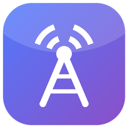

<p align="center"></p>

# Antenna

An IPTV player for Windows, built with WinUI 3 and LibVLC. It is an independent, clean-room
app with a feature set modelled on players like UHF on Apple platforms. It contains no code
or assets from any of them.

Antenna plays streams from playlists **you** supply (your IPTV provider's M3U URL or
Xtream Codes login). It doesn't include or find any content itself.

## Features

**Watching**
- Live TV, movies and series from M3U/M3U8 playlists (URL or file) and Xtream Codes accounts
- Instant channel switching in the player: Ch+/Ch− (Page Up/Down, gamepad bumpers), type a channel number, or pick from the channel list (L)
- Now/next overlay with channel logo and programme progress (I)
- Continue watching: movies and episodes resume where you stopped
- Audio tracks, embedded subtitles, subtitle files, and OpenSubtitles.com search
- Playback speed for VOD, mini player (always on top), full screen, auto-reconnect
- Cast to Chromecast devices on your network
- **Live events search**: type “man utd vs man city”, “NBA”, “Wimbledon” or tap a sport chip; finds live and upcoming matches across every guide (nicknames like *utd*, *spurs*, *psg* understood) and per-event channels; tick several and **watch them together**
- **Multi-view**: up to four matches playing at once; the selected tile is the main screen (slightly larger, the only one with sound) while the others keep playing silently; click a tile or press 1–4 to switch, Page Up/Down changes its channel; the channel picker lists every channel or every match for your search
- **Picture-in-picture**: pop the player into a small always-on-top window (P) and keep browsing; double-click it to come back
- Streams that need a particular user agent or referrer (`#EXTVLCOPT`, `url|User-Agent=…`) now play

**Guide and catch-up**
- XMLTV guide (.xml / .xml.gz), matched to channels by id then by name
- List view per channel/day, or a timeline grid of every channel
- Catch-up for Xtream (time-zone aware) and M3U catchup modes (default, append, shift, flussonic, xc)

**Recording**
- Record live TV now, or schedule from the guide (with padding); save catch-up to disk
- Download movies and episodes; Recordings page with progress, play and delete
- Scheduled recordings run while Antenna is open

**Library**
- Search across all playlists, with suggestions as you type
- Favourites, recently watched, continue watching ("My stuff")
- Pin categories to the top (and open them from My stuff → Pinned); hide categories; lock categories behind a parental PIN
- Edit, reorder, recolour and re-icon playlists
- Automatic background refresh of playlists and guides
- Backup and restore (playlists, favourites, category settings, preferences)

**Speed and looks**
- Lists load page by page off the UI thread; logos and posters are cached on disk
- Poster tiles and details pages (plot, cast, rating, backdrop) for movies and series
- Light/dark/system theme, custom title bar, Mica

**Security**
- Playlist passwords are encrypted with Windows DPAPI (only your Windows account can read them)
- Xtream credentials are kept out of stored stream URLs and guide links
- The parental PIN is stored only as a salted PBKDF2 hash

## Layout

```
antenna/
  src/Antenna.Core/        Cross-platform logic: playlists, Xtream, XMLTV guide, catch-up, SQLite library + search,
                           favourites/history/settings, backup, PIN hashing, OpenSubtitles, recording planner
  src/Antenna.App/         WinUI 3 app (Windows only)
  tests/Antenna.Core.Tests xUnit tests for the core library
```

## Run it on your PC

### Option A: download a ready-made build (no tools needed)

1. Open the repository's **Actions** tab on GitHub and select the latest green **Antenna** run.
2. Under **Artifacts**, download **Antenna-win-x64** (you must be signed in to GitHub) and unzip it.
3. Double-click `Antenna.App.exe`. It's self-contained: no .NET or Windows App SDK install needed.
   If SmartScreen warns about an unknown publisher, choose **More info → Run anyway** (the build is unsigned).

### Option B: build from source

1. Install the .NET 10 SDK: `winget install Microsoft.DotNet.SDK.10` (or download it from dot.net).
2. Get the code and switch to the branch:
   ```powershell
   git clone https://github.com/sammykev/miva-notes.git
   cd miva-notes
   git checkout sammykev/zen-ptolemy-3t0ch1
   cd antenna
   ```
3. Run it:
   ```powershell
   dotnet run --project src/Antenna.App -p:Platform=x64
   ```
   On an ARM PC (e.g. Snapdragon), use `-p:Platform=ARM64`.

### First steps in the app

1. **Playlists → Add playlist**: paste your provider's M3U URL, or choose **Xtream Codes** and enter
   the server, username and password.
2. Wait for "loaded N items and M guide entries".
3. Browse **Live TV / Movies / Series**, search from the box at the top of the pane, or open the **Guide**.
   In the guide, click what's on now to watch live, or a past programme marked **▶ Catch-up** to replay it.
   Catch-up only appears for channels your provider archives.

## Build and run (Windows), developer notes

Requirements: Windows 10 1809+ or Windows 11, the [.NET 10 SDK](https://dotnet.microsoft.com/download),
and optionally Visual Studio 2022/2026 with the "WinUI application development" workload.

```powershell
cd antenna
dotnet test tests/Antenna.Core.Tests
dotnet run --project src/Antenna.App -p:Platform=x64
```

Or open `Antenna.slnx` in Visual Studio, set `Antenna.App` as the startup project, pick `x64`,
and press F5. The app is unpackaged, so no certificate or MSIX install is needed.

Data lives in `%LOCALAPPDATA%\Antenna\library.db`.

CI (`.github/workflows/antenna.yml`) tests the core, builds the app on `windows-latest`,
and uploads a self-contained `Antenna-win-x64` build as an artifact.

## Keyboard shortcuts (player)

| Key | Action |
|---|---|
| Space / K | Play / pause |
| Page Up / Page Down (gamepad bumpers) | Next / previous channel |
| 0–9 | Type a channel number |
| L (gamepad Menu) | Channel list |
| I | Channel info (now / next) |
| P | Picture-in-picture |
| F, double-click | Full screen |
| Esc | Leave full screen / mini player |
| ← / → | Seek 10 s |
| M | Mute |
| Gamepad B | Back |

## Licences

LibVLC and LibVLCSharp are LGPL-2.1-or-later. They're linked dynamically from their NuGet
packages, which keeps Antenna's own code under whatever licence you choose. Keep the LibVLC
licence notices if you distribute builds.
